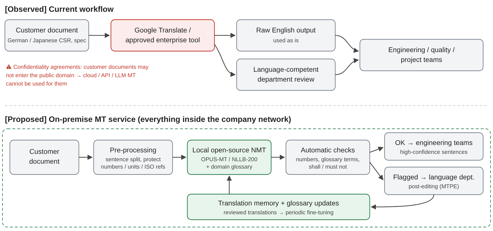

**AIML ZG519 – Natural Language Processing Applications · Group 81**

## Student details

| | |
| --- | --- |
| **Team member names** | RAJESH R. SHENOI (2025AE05200) · PARUL MITTAL (2025AE05198) · SIDDHARTH KUCHIMANCHI (2025AE05199) · CHAUHAN AYUSH UPENDRA (2025AE05684) |
| **BITS Email id** | 2025ae05200@wilp.bits-pilani.ac.in · 2025ae05198@wilp.bits-pilani.ac.in · 2025ae05199@wilp.bits-pilani.ac.in · 2025ae05684@wilp.bits-pilani.ac.in |
| **Industry / Domain** | Automotive |
| **Organisation type** | Automotive organisation that receives technical documents from German and Japanese automotive customers (workplace of group member Rajesh R. Shenoi; anonymised) |

> **How to read this report.** **[Observed]** marks how machine translation is used in the organisation today, as
> reported by the group member who works there. **[Proposed]** marks the group’s own suggestion and demonstration.
> No confidential, customer or personal information is included; all example sentences are synthetic.

## 5.1 Industry context – Anchor

| | |
| --- | --- |
| **Industry / Organisation** | Automotive; an organisation whose customers send technical documents in German and Japanese. |
| **Selected NLP concept** | Machine Translation (MT) – neural, Transformer‑based MT and LLM‑based translation. |
| **Application / use case** | **[Observed]** Translating German and Japanese customer documents – e.g. **customer‑specific requirements (CSRs)** and **vehicle specifications** – into English so that engineering, quality and project teams can understand and implement them. |
| **Problem addressed** | Customers write requirements in their own language while engineering works in English. A misunderstood requirement can cause a design error, a failed validation or a contractual non‑conformity. Full human translation of long specifications is slow and costly; MT gives engineers fast access to the content. |
| **Users / stakeholders** | Engineers and project managers (readers); the **language‑competent department** (reviewers); quality / requirements managers; the customer (owner of the document and its confidentiality); IT security and legal (approve tools, enforce confidentiality agreements). |
| **Status** | **Deployed** – MT is used today for this purpose. |

## 5.2 Concept in practice – Apply

**Data / input.** **[Observed]** German and Japanese customer documents: customer‑specific requirements and vehicle
specifications. Their language is special: obligations (*muss*, *しなければならない* → **shall**), prohibitions
(*darf nicht* → **must not**), numeric limits with units and signs (−40 °C, 320 Nm, 10 ms), references to standards
(ISO 26262) and dense terminology (*Steuergerät* – control unit, *Lastenheft* – requirements specification,
*耐久試験* – durability test).

**NLP approach / concept (course link).** Today’s MT systems are **neural encoder–decoder Transformers**: the encoder
builds contextual representations of the source sentence with self‑attention; the decoder generates the English
sentence token by token, attending to the source through cross‑attention, and **beam search** keeps the best partial
translations. Text is split into **sub‑word units** (SentencePiece), so long German compounds such as
*Dauerlaufprüfung* can still be translated. **Multilingual models** (NLLB‑200) share one network across ~200
languages; **LLMs** translate by prompting. Quality is measured automatically with **BLEU** (word n‑gram overlap)
and **chrF** (character n‑gram F‑score) against reference translations, and in practice by human **post‑editing
(MTPE)**.

**Tool / model / framework.** **[Observed]** Google Translate and other translation tools approved by the
enterprise. **[Proposed – demo]** Open‑source models run locally with HuggingFace `transformers`: Helsinki‑NLP
**OPUS‑MT** (Marian Transformer, ~75 M parameters, one model per language pair) and Meta **NLLB‑200 distilled**
(615 M parameters, multilingual).

**Workflow / architecture.**

* **[Observed] current workflow:** document received → translated with Google Translate or an approved tool →
  output **used as is** for understanding, or **reviewed by the language‑competent department** where accuracy
  matters. Customer **confidentiality agreements** forbid putting these documents into the public domain, so public
  web translators and API‑ or LLM‑based translation services cannot be used for them.
* **[Proposed] on‑premise workflow:** the document never leaves the company network → pre‑processing (sentence
  split, protect numbers, signs, units and standard names) → **locally hosted open‑source NMT** with a **domain
  glossary** → automatic checks (numbers, glossary terms, *shall / must not*) → flagged sentences go to the language
  department for post‑editing → reviewed translations feed a translation memory used for later fine‑tuning.

**Output / result.** **[Observed]** English versions of customer documents used by engineering, raw or after
review. **[Proposed – demo]** Translations, quality scores and checks below, produced **offline on a single CPU
thread** – the models were copied once to a local folder and loaded with `local_files_only=True`, so no text left
the machine.

**Evidence.**

*E1 – On‑premise MT demo* (`mt_demo.ipynb`, Google Colab CPU, 1 thread, beam size 4; 8 German and 6 Japanese
synthetic requirement sentences; references prepared by the group). Small test set – results are indicative only.

| Model (local, offline) | Pair | BLEU | chrF | Glossary terms correct | Numbers kept (auto‑check) | CPU s / sentence | Size on disk |
| --- | --- | ---: | ---: | :---: | :---: | ---: | ---: |
| OPUS‑MT de‑en | de→en | **75.8** | **82.6** | **9/10** | 8/8 | **0.86** | 299 MB |
| NLLB‑200 distilled 600M | de→en | 63.1 | 74.2 | 7/10 | 8/8 | 6.25 | 2.49 GB |
| OPUS‑MT ja‑en | ja→en | 28.7 | 55.6 | 7/10 | 6/6 | **0.89** | 304 MB |
| NLLB‑200 distilled 600M | ja→en | **49.0** | **72.3** | **9/10** | 6/6 | 6.90 | (same model) |

*E2 – Example outputs (synthetic sentences).*

| Source (synthetic) | MT output | Problem |
| --- | --- | --- |
| Das Steuergerät muss bei einer Umgebungstemperatur von -40 °C bis +85 °C fehlerfrei funktionieren. | OPUS‑MT: *The control unit **shall** function correctly at an ambient temperature of -40 °C to +85 °C.* | none – correct term, modal and numbers |
| Das **Lastenheft** gilt in Verbindung mit den kundenspezifischen Anforderungen … | NLLB: *The **package leaflet** shall be valid in conjunction with the customer‑specific requirements …* | wrong domain term (pharmaceutical sense) |
| 制御ユニットは、**-40℃**から+85℃の周囲温度で正常に動作しなければならない。 | NLLB: *… at ambient temperatures between **40°C** and +85°C.* | minus sign lost – **not caught** by the automatic number check |
| サプライヤーは、量産開始の**6週間前までに**…通知すること。 | NLLB: *… notify the customer … **within six weeks of** the start of mass production.* | deadline meaning changed (“at least six weeks before”) |
| 本仕様書に記載のない事項については、顧客と協議の上決定する。 | OPUS‑MT: ***I’ll** decide on matters that don’t appear in **my** specs in a discussion with **my** customers.* | omitted Japanese subject filled with an invented “I” |
| 耐久試験は、1,000時間以上実施すること。 | OPUS‑MT: *The endurance exam **should** take more than 1,000 hours.* | obligation weakened to “should” (a recommendation in standards language) |

*E3 – Workflow diagram* (above). Screenshots of the internal tools are omitted because of confidentiality.

## 5.3 Industry analysis – Analyse

**Key benefits / value.**

* **Speed and access:** engineers can read a German or Japanese specification immediately instead of waiting for a
  full human translation – valuable during quotations and change requests.
* **Cost:** expert review is focused on documents and passages that need it, instead of translating every page by hand.
* **Coverage:** one workflow serves German and Japanese customers; multilingual models can add further languages.

**Limitations / problems.**

* **Confidentiality (major):** **[Observed]** customer agreements forbid uploading documents to public domains,
  which rules out public web translators, cloud MT APIs and LLM services for exactly the documents that most need
  translating.
* **Domain terminology:** general models do not know automotive terminology – *Lastenheft* became “package
  leaflet”, OPUS‑MT rendered *Bordnetz* (vehicle electrical system) as “on‑board system” (glossary 7–9 of 10 terms per model, E1).
* **Requirement semantics:** a fluent translation can still change a requirement: a lost minus sign, a changed
  deadline, *shall* weakened to *should*, an invented subject (E2). These errors look correct, so raw output is risky.
* **Japanese is harder than German:** the best Japanese result (chrF 72.3) is clearly below the best German one
  (82.6) – long sentences and omitted subjects.
* **Simple checks are not enough:** the automatic number check passed all sentences, yet missed the lost minus sign.
* **Raw output risk:** **[Observed]** output is sometimes used as is, without review.

**Evidence of effectiveness or impact.** **[Observed]** MT is part of the daily workflow for German and Japanese
documents, with the language department as the quality gate – it is useful enough to have been adopted.
**[Proposed – demo]** Local open‑source models reach usable quality without any data leaving the machine: OPUS‑MT
de→en scores chrF 82.6 with 9/10 glossary terms correct at 0.86 s per sentence on one CPU thread (about 1.5 minutes
for a 100‑sentence document), and NLLB‑200 is the better choice for Japanese (chrF 72.3 vs 55.6, 9/10 terms).
No single model is best for both pairs, and every model made at least one terminology or meaning error, so
on‑premise MT must be combined with a glossary, better checks and human review.

## 5.4 Reflection and future scope – Reflect

**Major challenge / gap.** **Confidentiality.** The best‑known MT and LLM services are cloud‑based, but customer
confidentiality agreements do not allow these documents to leave the organisation. The documents that matter most
therefore cannot use those tools, and translation falls back to slower manual work or carries a compliance risk.

**Recommended improvement.** **[Proposed]** An **on‑premise MT service** inside the company network:

1. **Per‑language model selection** based on a small internal test set – e.g. OPUS‑MT for German and NLLB‑200 for
   Japanese in our demo.
2. A **domain glossary / terminology database** enforced during or after translation (*Lastenheft* →
   *requirements specification*).
3. **Stronger automatic checks** for signs, numbers, units, deadlines and *shall / must not / should*, and
   **routing** of flagged sentences to the language department for post‑editing.
4. **Fine‑tuning** on the organisation’s reviewed translations (translation memory) to adapt the model to its
   customers’ style.

*Requirements:* approval from IT security and legal; an internal server (the demo shows that small models run on a
CPU; a GPU or more CPU threads would speed up the larger model); an owner for the glossary; and a test set with
reference translations to measure quality before and after roll‑out.

**Potential future use.** Comparing **new versions of customer documents** in English to highlight changed
requirements; **multilingual search / RAG** over past specifications; automatic **extraction of requirements**
into the requirements‑management tool after translation (link to Information Extraction, Part 1); and an
on‑premise open **LLM** for translation and summarisation once suitable hardware is available.

## References and acknowledgements

* Vaswani, A. et al. (2017). *Attention Is All You Need.* NeurIPS.
* Tiedemann, J. & Thottingal, S. (2020). *OPUS‑MT – Building open translation services for the World.* EAMT.
* NLLB Team (2022). *No Language Left Behind: Scaling Human‑Centered Machine Translation.* arXiv:2207.04672.
* Post, M. (2018). *A Call for Clarity in Reporting BLEU Scores.* WMT (sacreBLEU).
* Popović, M. (2015). *chrF: character n‑gram F‑score for automatic MT evaluation.* WMT.
* Tools: HuggingFace `transformers`, `sacrebleu`, Google Colab. Models: `Helsinki-NLP/opus-mt-de-en`,
  `Helsinki-NLP/opus-mt-ja-en`, `facebook/nllb-200-distilled-600M`.
* Organisational practice described by group member Rajesh R. Shenoi (anonymised).
* AI tools: Claude Code (Anthropic) helped structure the report, write the demo notebook and prepare the synthetic
  sentences and reference translations; all content was reviewed by the group.
